# omni-api

**Every local model your app needs, behind one port.**

omni is a local CLI. It runs, supervises and serves the models an app needs (chat, decisions, embeddings, images, video, speech-to-text and text-to-speech) on `127.0.0.1:10000`. Apps call a *role* such as `chat` or `tts`, never a model name or an engine port. Wherever an OpenAI format exists, omni uses it, so any OpenAI SDK works once you change its `base_url`.

The first client is Hyperlight.

## Screenshots

[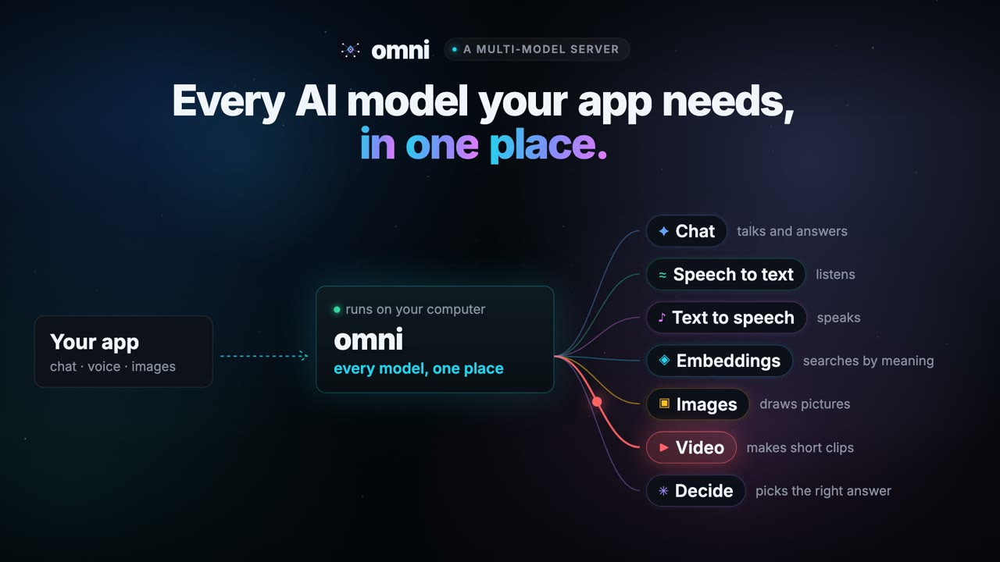](marketing/omni-launch-16x9.mp4)

A 53 s silent tour: why one app needs many models, how omni sets them up, the real playground, and the install commands. [Watch the film](marketing/omni-launch-16x9.mp4) or open the [product page](https://nvkudva.github.io/omni-api/). Every screenshot below is the real playground, in the dark and the light theme (the toggle sits in the top bar; it follows your system until you pick one).

| Dark | Light |
|---|---|
| 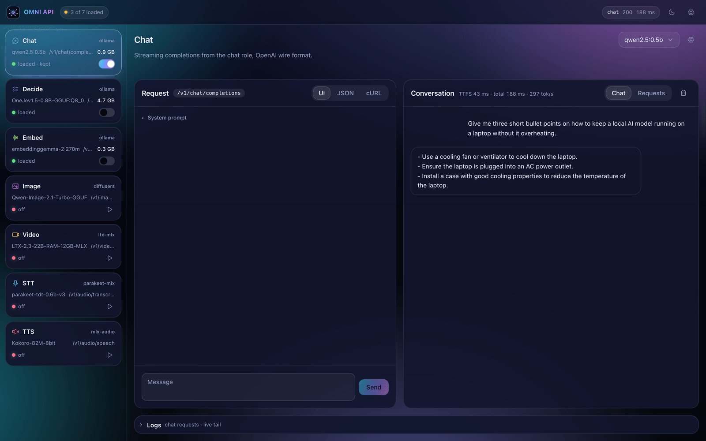 | 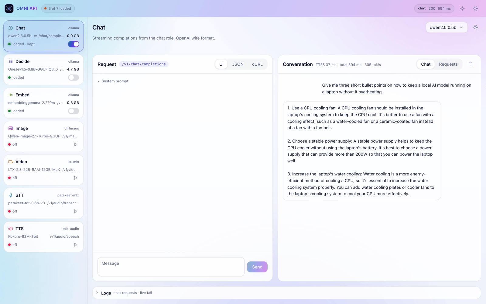 |

The playground at `/`: every role is a card in the left rail (runtime, model, one status that says what it is doing, and the switch that keeps it loaded), each role page is a workbench with a UI / JSON / cURL view of the same request, and that role's live request log sits under it.

| Dark | Light |
|---|---|
| 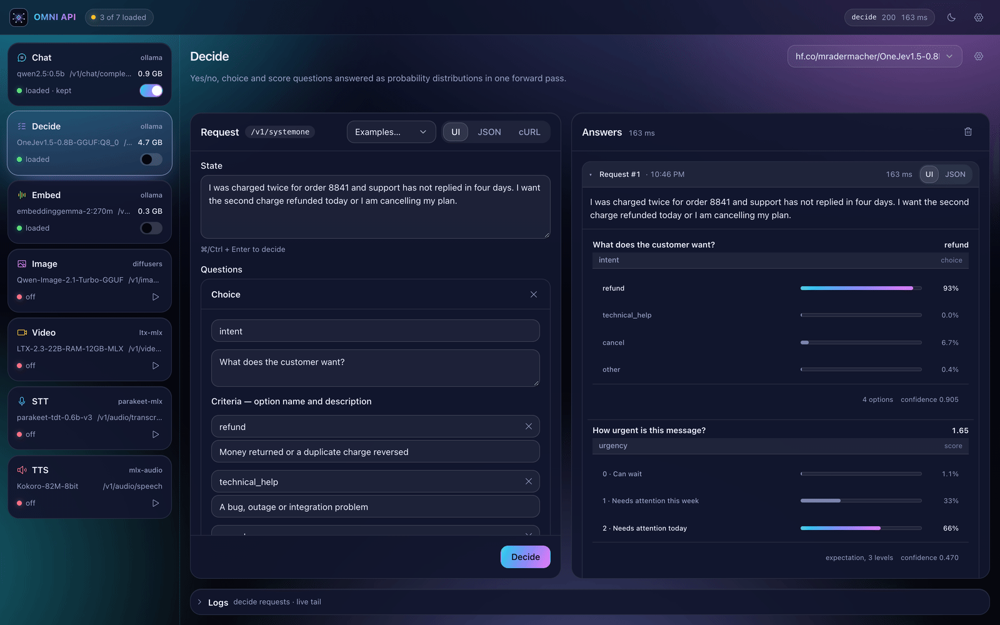 | 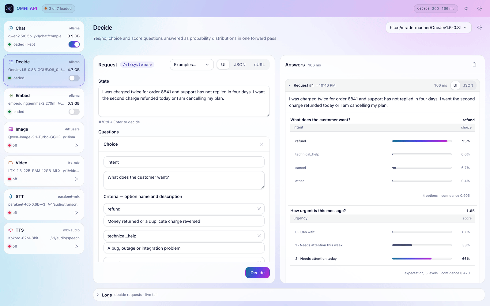 |
| 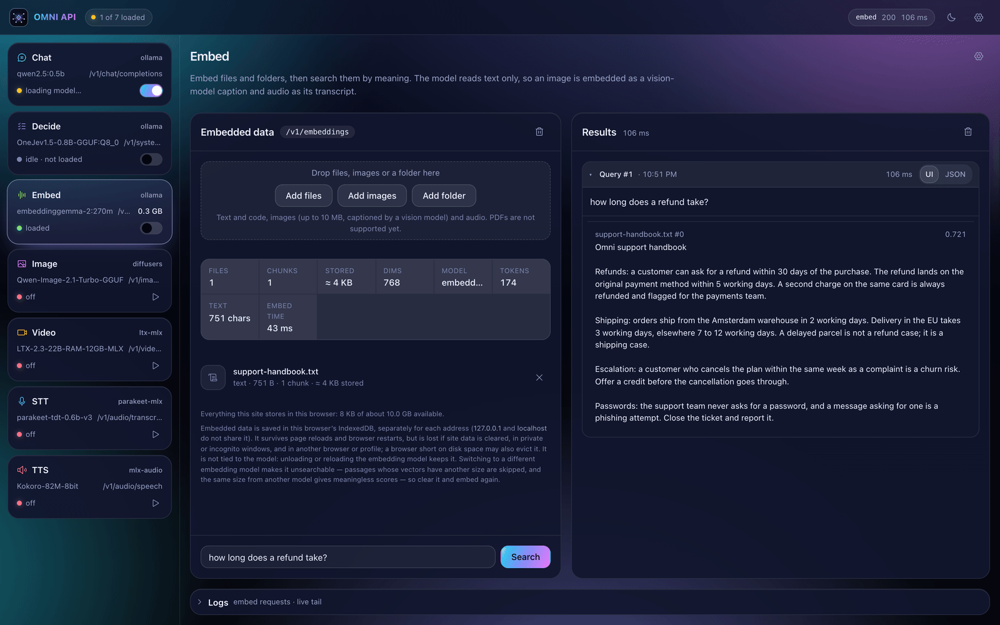 | 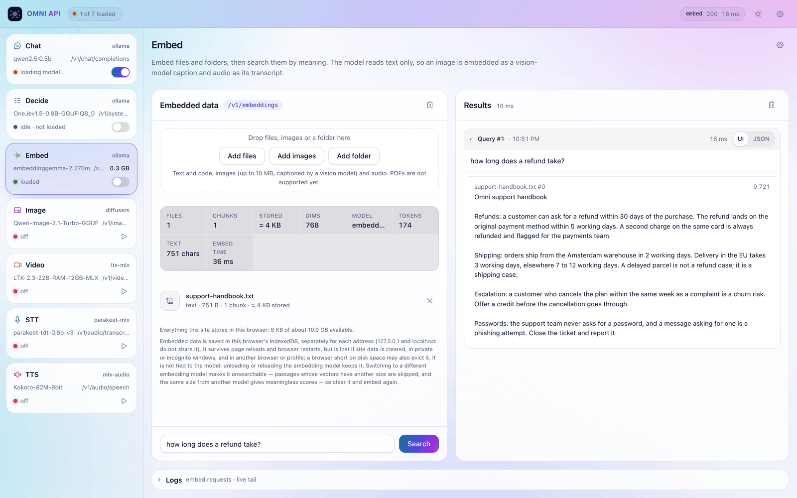 |

**Decide** answers noul, choice and score questions as probability distributions, in one forward pass. **Embed** indexes files, folders, images and audio, then searches them by meaning.

| Dark | Light |
|---|---|
| 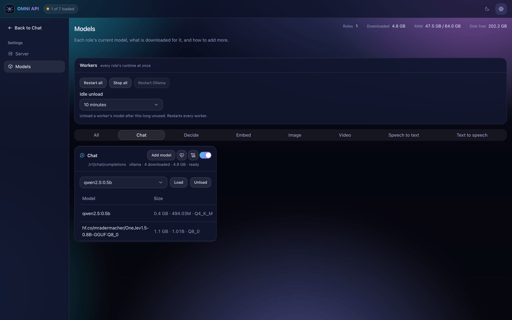 | 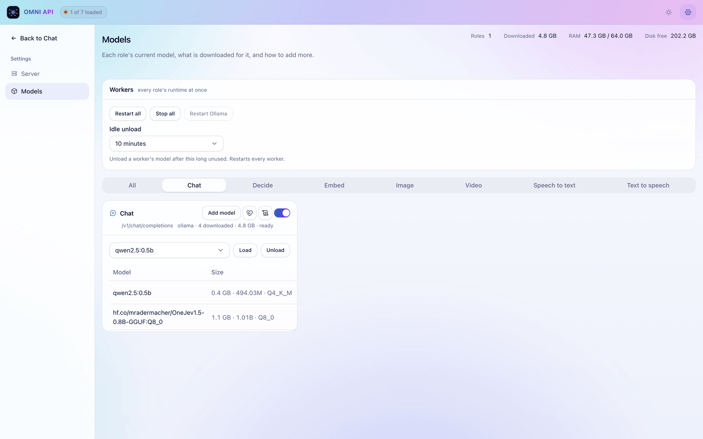 |
| 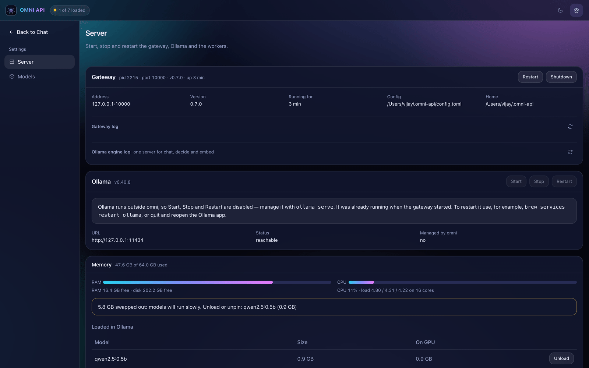 | 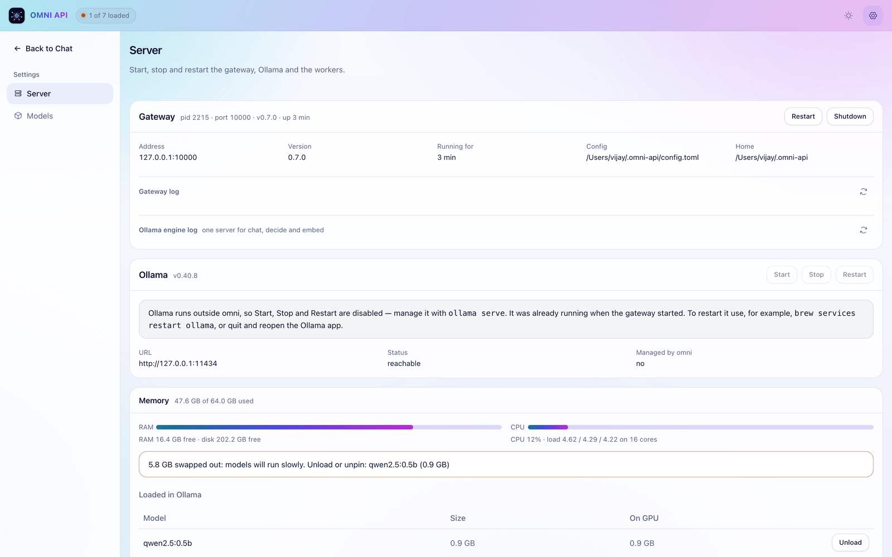 |

**Settings → Models** lists every role's models, what is on disk, what is loaded and how to add more. **Settings → Server** holds the gateway, Ollama and worker controls plus the memory and CPU meters.

It fits a phone as well: the role cards become a strip and the panels stack.

| Dark | Light |
|---|---|
| 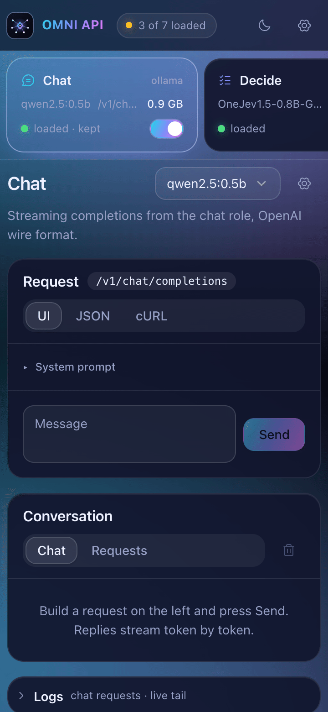 | 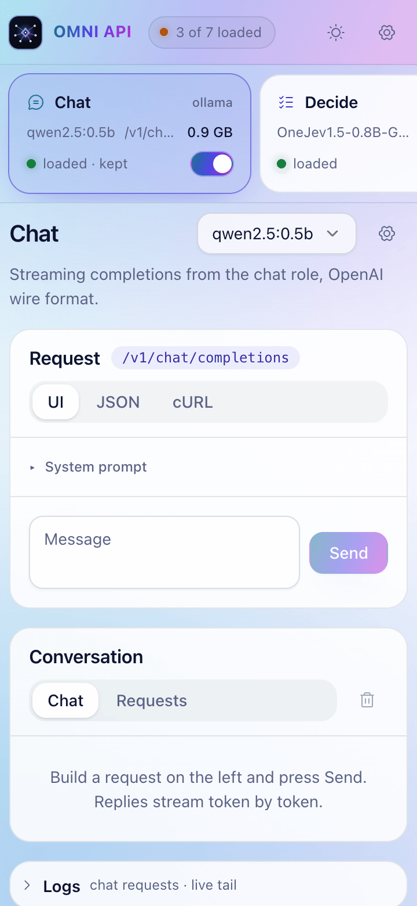 |

---

## How it works

```
apps ──► 127.0.0.1:10000  omni gateway (FastAPI + httpx streaming proxy)
           /v1/chat/completions      ──► Ollama          OLLAMA_HOST, else 127.0.0.1:11434
           /v1/systemone             ──► Ollama          same instance, scored in the gateway
           /v1/embeddings            ──► Ollama          same instance, EmbeddingGemma task prompts added in the gateway
           /v1/images/generations    ──► image worker    unix:~/.omni-api/run/image.sock
           /v1/videos                ──► video worker    unix:~/.omni-api/run/video.sock
           /v1/audio/transcriptions  ──► stt worker      unix:~/.omni-api/run/stt.sock
           /v1/audio/speech          ──► tts worker      unix:~/.omni-api/run/tts.sock
           /, /static            ──► built playground (src/omni/static/app)
```

- **Gateway** (`src/omni/gateway/`): the FastAPI app (`app.py`) builds the shared context and mounts one module per route family (`routes/`). `proxy.py` streams each request through to its worker with httpx, filling in the default chat model when the request leaves `model` out.
- **Supervisor** (`src/omni/supervisor/`):
  - `pool.py` spawns each worker in its own process group and probes `/health` every 2 s.
  - Restarts failed workers with exponential backoff, one lock per worker so a restart and the watch loop never overlap.
  - `process.py` records each child's pid and command line, so on `down` only a pid that is still ours is signalled; leftover workers from an earlier run are cleaned up on start.
- **Workers** (`src/omni/workers/`): each role runs in its own uvicorn process, so a crash or memory spike in one model never takes down the others. Each loads its model on first use behind one lock; the gateway unloads it once idle, since it sees every request and pin.
- **Chat and embed** use the machine's own Ollama address (`OLLAMA_HOST`, else `127.0.0.1:11434`). If nothing answers there, omni spawns `ollama serve` on that same address; it never moves Ollama to another port.
- **Decide** (`src/omni/workers/decide.py`, `src/omni/inference/vega.py`) runs [Vega](https://huggingface.co/nvkudva/vega-onnx-q8) on ONNX Runtime, in its own worker. A frozen Qwen3.5-0.8B reads the state and one typed question; a small physics engine turns the pooled hidden states into option logits; a per-type temperature and a conformal threshold turn those into calibrated probabilities, a prediction set, and `abstain` and `unbound` flags. It is not a generative model. The prompt, pooling and calibration are a port of the [browser runtime](https://github.com/nvkudva/vega-web), checked against its parity set (identical token ids and spans; every argmax kept). An image can stand in for the text state (zero-shot: the engine was trained on text features).
- **Image** (`src/omni/workers/image.py`) runs `QwenImage21Pipeline` from diffusers on MPS in bf16. `[image] steps` sets the default step count.

---

## Usage

```sh
omni             # print this guide, grouped by what you are doing
omni init        # ask before installing Ollama, pull chat/embed, download and start decide/stt/tts
omni init --media  # also load the image/video models now, not on first request
omni doctor      # report what works and what to fix, without changing anything
omni serve       # foreground: gateway + all workers
omni up          # same, in the background, and opens the playground (`--no-browser` skips that)
omni up --foreground  # what `serve` does, if you would rather not remember two verbs
omni status      # worker health as a table; `--json` for the raw report
omni logs        # the gateway log; `-f` follows it, `omni logs stt` shows one worker's, `omni logs ollama` the engine's
omni restart     # stop and start again on the same address, rereading the config
omni down        # stop the gateway and every worker
omni config      # show the effective settings; `config set`, `config check` also exist
```

Every command names its own flags: `--host`/`--port` belong to `serve` and `up` alone, and
`status`/`restart` read the address the gateway recorded. `omni config set gateway.port 10001`
persists a change; `omni restart` applies it.

Then open **http://127.0.0.1:10000/**.

### Playground

Preact + CSS modules, built with Vite from `web/` into `src/omni/static/app/` (the built files are checked in, so `omni up` needs no Node). After editing `web/`:

```bash
cd web && bun install && bun run build   # rebuild into src/omni/static/app
bun run dev                              # hot-reload dev server on :5180, proxies the API to :10000
```

Light, dark or system theme, cycled from the header. The left rail holds one card per role — runtime, model, one status word, and the switch that keeps it loaded — and the header counts what is resident (`3 of 7 loaded`). Each role page is a workbench with the request on the left, the result on the right, and that role's live request log underneath:

- **Chat**: streaming replies with time-to-first-token, total time and a token rate. An attach button appears when the model has Ollama's `vision` capability.
- **Decide**: yes/no (noul), choice and score questions, answered as probability distributions. The example dropdown fills in a whole question set.
- **Embed**: drop files, images, audio or a whole folder, and they are embedded and searchable by meaning. The index lives in the browser (IndexedDB), so it survives a reload.
- **Image**: prompt, size, steps, seed and negative prompt; shows and downloads PNGs.
- **Video**: prompt, size, length, seed and an optional first frame; queues a job, polls it and plays the mp4.
- **STT**: record from the mic or upload a file; shows a transcript with segment timings.
- **TTS**: pick a voice and speed, play the result, and run a round trip back through stt.
- **Settings → Server**: the gateway (restart, shutdown), Ollama, the workers, the memory and CPU meters, and the gateway and engine logs.
- **Settings → Models**: every role's models, what is on disk, what is loaded, the idle-unload window, and Find & Install for more.

A request that is still running can be stopped, and a finished one is kept by the server: close the tab and the work still completes, and its result is there when you come back.

---

## Cool features

- **Decide without generation:** `/v1/systemone` scores yes/no, choice and score questions with one forward pass — no generated text to parse, with calibrated probabilities per option, a conformal prediction set and an abstain flag.
- **Keep-warm pins:** pin a role and its model stays loaded (Ollama `keep_alive = -1`; the gateway never idles a pinned worker out). Pins persist across restarts.
- **Three views, one request:** every playground page shows UI, raw JSON and a copyable cURL command for the exact body it sends.
- **Runs survive a closed tab:** the gateway keeps the request and its result, so closing the browser does not cancel the work — reopen it and the answer is there. A running request can also be stopped.
- **Live per-role logs:** the request log of every role, tailed in the playground and in `omni logs`.
- **Search your own files:** the embed role indexes text, code, images (captioned by a vision model) and audio (transcribed by stt) in the browser, then ranks the chunks against a query.
- **Find & Install:** per-role Hugging Face / Ollama search filtered to what that role's runtime can actually run, with gated-repo "accept terms" handling, live download progress and a stop button.
- **Self-healing workers:** per-worker locks, exponential-backoff restarts, pid + argv verification so a recycled pid is never signalled, and no orphan processes on `omni down`.
- **One error shape everywhere:** gateway, workers, routing 404/405 and validation 422 all return `{"error": {"message", "type"}}`.
- **Hardened local surface:** 8 MB JSON body caps (413), raised only where a request carries an image, audio or video, finite upstream timeouts, loopback-only by default — a non-loopback `--host` is refused unless `OMNI_ALLOW_NON_LOOPBACK=1` (admin routes have no auth, by design for a local-only tool).

---

## Why

A local-first AI app usually ends up juggling:

- Ollama on one port, a Python embedding server on another, and a speech model on a third.
- A different download step, start command and memory profile for each.
- Model names hard-coded across the app, so swapping a model breaks things.

omni brings all of that together:

| Goal | How |
|---|---|
| **One endpoint** | A single gateway on `127.0.0.1:10000` routes by path. Apps never see engine ports. |
| **Roles, not models** | Apps call `chat`, `decide`, `embed`, `image`, `video`, `stt` and `tts`. Config maps each role to a model, so swapping one never breaks an app. |
| **OpenAI-compatible** | `/v1/chat/completions`, `/v1/embeddings`, `/v1/images/generations`, `/v1/audio/transcriptions` and `/v1/audio/speech` follow OpenAI's wire format. Errors use OpenAI's shape. |
| **Light on memory** | Workers load their model on the first request and unload it after 10 idle minutes. |
| **Self-healing** | A supervisor health-checks every worker and restarts it with backoff. `omni down` leaves no orphan processes. |
| **Local only** | Binds `127.0.0.1`. Python workers listen on Unix sockets, not TCP. |

---

## What it can do

| Role | Endpoint | Default model | Engine |
|---|---|---|---|
| **chat** | `POST /v1/chat/completions` (streaming) | `qwen2.5:0.5b` | Ollama |
| **decide** | `POST /v1/systemone` | `nvkudva/vega-onnx-q8` (8-bit ONNX, ~0.93 GB); also Laya (English and multilingual) and GLiNER2.5-Decide | ONNX Runtime (Vega), transformers (Laya, GLiNER2.5) |
| **embed** | `POST /v1/embeddings` | `embeddinggemma-2` | Ollama |
| **image** | `POST /v1/images/generations` | `unsloth/Qwen-Image-2.1-Turbo-GGUF` | diffusers (MPS, Q8_0) |
| **video** | `POST /v1/videos`, `GET /v1/videos/{id}`, `GET /v1/videos/{id}/content` | `QuantStack/Wan2.2-TI2V-5B-GGUF` (Wan 2.2 TI2V-5B, Q8_0) | diffusers (also runs LTX-Video GGUFs) |
| **stt** | `POST /v1/audio/transcriptions` | `istupakov/parakeet-tdt-0.6b-v2-onnx` (English, int8, ~0.7 GB); also Moonshine Tiny, Whisper Small and oruk-loop | onnx-asr, transformers |
| **tts** | `POST /v1/audio/speech`, `GET /v1/audio/voices` | `onnx-community/Kokoro-82M-v1.0-ONNX` (int8, ~0.12 GB, 27 voices); also Kitten TTS Nano/Mini and Supertonic 3 | ONNX Runtime |
| — | `GET /health`, `GET /v1/models` | | |
| — | `GET /admin/models`, `GET /admin/models/{search,status,downloads,check}`, `POST /admin/models/{pull,pull/stop,delete,default,load,unload}` | list, search Hugging Face (per-role filter), check a model id, install (with progress), delete, switch, load and unload | |
| — | `GET /admin/pins`, `POST /admin/pins` | keep a role's model resident, and re-apply that on the next start | |
| — | `POST /admin/workers/{name}/{start,stop,restart}`, `GET /admin/memory` | start, stop and restart the workers; RAM, swap, disk, CPU, load average and per-worker RSS | |
| — | `GET /admin/requests`, `GET /admin/requests/{id}`, `GET /admin/requests/{id}/result`, `DELETE /admin/requests/{id}` | the running and recently finished requests, kept on the server | |
| — | `GET /admin/server`, `POST /admin/server/{restart,stop}`, `POST /admin/settings`, `GET /admin/logs`, `GET /admin/logs/{role}` | the gateway's own state and controls, one persisted setting, the logs | |
| — | `GET /` | browser playground for every endpoint (`/playground` redirects here) | |

Measured on Apple Silicon:

- chat streams at about 140 tok/s with `qwen2.5:3b`, and faster with the shipped 0.5b default.
- A warm embed takes 0.03–0.15 s.
- tts runs at about 12× realtime: 8 s of audio in 0.64 s.

---

## Install

On macOS (Apple Silicon) this installs every role. On Linux the default install serves chat and embed through Ollama and decide on ONNX Runtime; add `--media` for the stt, tts and video workers (video runs diffusers on CUDA or CPU there). The image worker renders on Metal, so it stays macOS-only. [Ollama](https://ollama.com) comes with `omni init` if missing, and Python plus [uv](https://docs.astral.sh/uv/) come with the script:

```sh
curl -fsSL https://raw.githubusercontent.com/nvkudva/omni-api/main/install.sh | sh
```

That installs the global `omni` command and every runtime the playground can start, but no models. Run `omni init` once afterwards: it installs Ollama if missing and downloads the chat, embed, decide, speech-to-text and text-to-speech models (several GB). Image and video are tens of GB, so they wait until first use or `omni init --media`. Homebrew users on macOS can tap this repo instead:

```sh
brew tap nvkudva/omni
brew trust nvkudva/omni      # Homebrew 7+ refuses untrusted third-party taps
brew install omni
```

The first install downloads the Python packages the workers need (torch, diffusers, ONNX Runtime) and prints uv's progress as it goes; wheels are cached under `~/Library/Caches/Homebrew/uv`, so a reinstall or upgrade takes under a minute.

Homebrew installs the command and its runtimes but no models, because a formula must not download them. Run `omni init` once afterwards.

### Uninstall

Installed with the script:

```sh
curl -fsSL https://raw.githubusercontent.com/nvkudva/omni-api/main/uninstall.sh | sh
# add --purge to also delete ~/.omni-api (config, pins, logs):  ... | sh -s -- --purge
```

Installed with Homebrew:

```sh
brew uninstall omni
brew untap nvkudva/omni      # optional
```

Both leave downloaded models alone (`~/.ollama`, `~/.cache/huggingface`); delete those yourself to reclaim the disk. Run `omni down` first if the gateway is still running (the script does it for you).

From a clone, for development (`-e` makes edits take effect immediately):

```sh
uv tool install -e ".[media]"    # every role this machine supports
uv tool install -e .             # chat, decide and embed only (no stt, tts, image or video)
# or run it without installing
uv run omni serve
```

Then:

```sh
omni init     # validate config, install Ollama if missing, pull chat/embed, load decide/stt/tts
omni up       # gateway and workers in the background
```

`omni init` validates `~/.omni-api/config.toml`, asks whether to install Ollama when the binary is missing (it stops if you say no), starts the server it just installed, pulls the chat and embed models and confirms they landed, then starts the gateway and loads the decide, stt and tts models (downloading them first); every failure prints the command to fix it and a link. The image and video models download on first use, or now with `omni init --media`. When something is wrong and you would rather not install anything, `omni doctor` runs the same checks read-only and prints one line per check. Release and packaging notes live in [`docs/publishing.md`](docs/publishing.md).

The shipped defaults are the small profile: `qwen2.5:0.5b` (chat), `vega-onnx-q8` (decide, 0.93 GB), `embeddinggemma-2` (embed, 1.3 GB), `parakeet-tdt-0.6b-v2-onnx` (stt, 0.7 GB), `Kokoro-82M-v1.0-ONNX` (tts, 0.12 GB), `Qwen-Image-2.1-Turbo` at Q8_0 (image, 7.6 GB transformer, about 26 GB once the shared text encoder and VAE land) and `Wan2.2-TI2V-5B` at Q8_0 (video, 5.4 GB transformer, about 20 GB with its text encoder and VAE). Any role can be changed in the playground (add a model, set it as default) or in `~/.omni-api/config.toml`; each role's list keeps the bigger models one click away.

---

## API examples

Works with the OpenAI SDK:

```python
from openai import OpenAI

client = OpenAI(base_url="http://127.0.0.1:10000/v1", api_key="local")

client.chat.completions.create(model="qwen2.5:0.5b", messages=[{"role": "user", "content": "hi"}])
client.embeddings.create(model="embed", input=["refund policy", "shipping times"])  # "embed" = the role's model
client.images.generate(model="image", prompt="a lighthouse at dawn", size="1024x1024")
client.audio.speech.create(model="tts", voice="af_heart", input="Hello from omni.").write_to_file("out.wav")
client.audio.transcriptions.create(model="stt", file=open("out.wav", "rb"))
```

Or with curl:

```sh
# chat (streaming)
curl -N localhost:10000/v1/chat/completions -H 'content-type: application/json' \
  -d '{"messages":[{"role":"user","content":"Say hi"}],"stream":true}'

# embeddings — input_type is "query" or "document" (EmbeddingGemma task prompts)
curl localhost:10000/v1/embeddings -H 'content-type: application/json' \
  -d '{"input":"how do I get a refund?","input_type":"query"}'

# image → png (Qwen-Image-2.1-Turbo; first call loads the model)
curl localhost:10000/v1/images/generations -H 'content-type: application/json' \
  -d '{"prompt":"a lighthouse at dawn","size":"1024x1024","steps":20}' | jq -r '.data[0].b64_json' | base64 -d > out.png

# text to speech → wav
curl localhost:10000/v1/audio/speech -H 'content-type: application/json' \
  -d '{"input":"Hello from omni.","voice":"af_heart"}' -o hello.wav

# speech to text — response_format: json | text | verbose_json
curl localhost:10000/v1/audio/transcriptions -F file=@hello.wav -F response_format=verbose_json

# decide — noul takes no criteria; choice needs a dict of 2 or more; score needs a list of 2 or more
curl localhost:10000/v1/systemone -H 'content-type: application/json' -d '{
  "state": "I have asked three times and still no refund!",
  "questions": {
    "is_frustrated": {"type": "noul", "instructions": "Does the customer sound frustrated?"},
    "topic": {"type": "choice", "instructions": "What is this about?",
              "criteria": {"billing": "money, refunds", "shipping": "delivery"}}
  }
}'

# video — a job: create, poll, then fetch the mp4
curl localhost:10000/v1/videos -H 'content-type: application/json' -d '{"prompt": "a paper boat in the rain", "size": "704x480", "seconds": 4}'
curl localhost:10000/v1/videos/video_abc123            # status: queued | in_progress | completed | failed
curl localhost:10000/v1/videos/video_abc123/content -o clip.mp4

# models — install streams NDJSON progress; ollama roles take an Ollama name or hf.co/<repo>:<quant>
curl localhost:10000/admin/models/pull -H 'content-type: application/json' -d '{"role": "chat", "model": "qwen2.5vl:7b"}'
curl localhost:10000/admin/models/default -H 'content-type: application/json' -d '{"role": "chat", "model": "qwen2.5vl:7b"}'
curl localhost:10000/admin/memory                      # RAM, swap, disk, CPU %, load average, per-worker status/RSS/CPU
curl 'localhost:10000/admin/models/search?role=tts&q=kokoro'   # only repos the role's runtime can run
curl localhost:10000/admin/models/load -H 'content-type: application/json' -d '{"role": "chat"}'   # 409 on a problem with this model; add "force": true
curl localhost:10000/admin/models/unload -H 'content-type: application/json' -d '{"role": "chat"}'
curl localhost:10000/admin/pins -H 'content-type: application/json' -d '{"role": "stt", "pinned": true}'  # keep it loaded
curl -X POST localhost:10000/admin/workers/tts/stop    # start | stop | restart; ollama runs outside omni

# voices and logs
curl localhost:10000/v1/audio/voices                   # 27 Kokoro voices, with the default one
curl 'localhost:10000/admin/logs/stt?lines=50'        # one role's log; /admin/logs is the gateway's

# requests kept by the server — running now, and the ones just finished
curl localhost:10000/admin/requests
curl localhost:10000/admin/requests/exec_abc123/result
```

Send your own `x-omni-exec: <id>` header with a request and the gateway keeps that request and its
result, so `GET /admin/requests/<id>/result` replays it later — the work does not stop when the
client goes away. Re-posting a finished id replays it instead of running it again.

Every error uses the same shape: `{"error": {"message": "...", "type": "..."}}`. A `load` or a `pin`
that is refused because of something about *that* model answers `409` with `type: "overload"` and the
reasons in `error.blockers`; machine-wide pressure (swap, CPU, load average) is returned as
`advisories` instead, and never blocks a load.

### Keeping a model warm

The gateway drops a worker's model after `idle_unload_minutes` with no request, so the card switch in
the playground is a *pin*: turning it on loads the model now and holds it — the gateway skips a pinned
worker when it unloads idle ones, and an Ollama model is held with `keep_alive = -1`. Pins persist in
`~/.omni-api/pins.json` and are re-applied at startup, so a pinned role is warm again within a minute
of `omni up` without anyone sending a request.

The card says which of those is true right now, in one word, and the wording is the only status on
the card, so it can never disagree with the switch beside it:

| the card reads | what is true | what it offers |
| --- | --- | --- |
| `warm` | in memory, and held there | switch on — turn it off to let it unload |
| `running` | in memory now, but it unloads once idle | switch off — turn it on to hold it |
| `loading…` | held, and on its way into memory | switch on — turn it off to stop holding it |
| `not running` | not in memory; the next request loads it | switch off |
| `starting…` | the worker is coming up | — |
| `stopped` | the worker is down; for chat and embed, Ollama itself is not answering | Start, or Server for the Ollama cases |
| `failed` | the worker keeps failing | Start — its log in Settings has the reason |
| `needs setup` | this role's default model cannot run here | Setup |

---

## Configuration

Defaults ship in `src/omni/catalog.toml`. To override any value, put it in `~/.omni-api/config.toml`; it is layered on top of the defaults:

```toml
[gateway]
port = 10000
idle_unload_minutes = 10

[chat]
model = "qwen2.5:0.5b"   # the shipped default; a bigger one is one click away

[tts]
voice = "af_heart"
```

Set `OMNI_HOME` to move the state directory (default `~/.omni-api`):

| Path | Contents |
|---|---|
| `run/` | pidfiles, one socket per worker generation, and the stable `<role>.sock` link clients dial |
| `logs/` | one log per worker, plus `omni.log` and `requests/<role>.log` for the roles Ollama serves |

Ports:

| Port | Use |
|---|---|
| 10000 | gateway |
| `OLLAMA_HOST` or 11434 | Ollama, reused or spawned on the machine's configured address |

---

## Notes and limits

- **The first request to each role is slow.** It loads the model, and some roles download on first use.
  Pin the ones you use often (the card switch in the playground, or `POST /admin/pins`) and they stay
  loaded instead:
  - **image:** loading Qwen-Image-2.1-Turbo takes about a minute; each 1024² image takes under a minute at 8 steps.
  - **video:** Wan 2.2 TI2V-5B at Q8_0 is 5.4 GB, plus about 14 GB for its text encoder and VAE, fetched on the first load from the diffusers repo named by `video.base`. Ollama can't run video models, so this runs diffusers (Metal, CUDA or CPU) and needs `ffmpeg` to write the mp4. LTX-Video GGUFs also load.
  - **stt:** besides Parakeet, `UsefulSensors/moonshine-tiny` (27M, English), `openai/whisper-small` (about 100 languages) and `oruk/oruk-loop-153M` (English; its repo's own code runs, so only that exact repo is trusted, and it needs about 4 GB RAM; free for non-commercial and small-business use) load through transformers on the CPU. The Parakeet path runs the int8 ONNX files of a Parakeet repo on the CPU (`istupakov/parakeet-tdt-0.6b-v3-onnx` adds 25 European languages). It needs `ffmpeg` to read audio, and transcribes long files in 3-minute windows.
  - **tts:** the first call also downloads a spaCy model.
- **Ollama roles are never downloaded by a load.** `POST /admin/models/load` (and a pin) answers `409`
  `conflict` for an Ollama model that is not installed; install it with `POST /admin/models/pull` first.
  Worker roles are different — loading them does download the repo on first use.
- **Model downloads fail with `network is unreachable` and an IPv6 address.** The network hands out an
  IPv6 address but does not route it, and Ollama tries the host's IPv6 address first. Switch IPv6 to
  link-local only, then restart Ollama:
  ```
  networksetup -setv6LinkLocal Wi-Fi
  ```
  Undo it with `networksetup -setv6automatic Wi-Fi`. On Ethernet, find the service name with
  `networksetup -listallnetworkservices`. The same switch is in System Settings > Network > Details >
  TCP/IP > Configure IPv6.
- **Background runs inside agent sandboxes** may be stopped after a time limit. For long sessions, run `omni serve` in your own terminal.
- **tts voices:** American and British English only, since misaki[en] covers just those two.
- **embed reads text.** Images are embedded as a vision-model caption and audio as its stt transcript; PDFs are not supported yet. The index itself lives in the browser (IndexedDB), not on the server, so it is per-browser and per-address.
- **Not yet built:** `omni pull`, `omni test`, `omni bench`, and the WebSocket `/v1/realtime` (wake word, VAD and streaming speech).

## Project docs

- [`PLAN.md`](PLAN.md): architecture, decisions and rejected alternatives.
- [`TODO.md`](TODO.md): milestone checklist.

`web/` holds the playground source (Preact + CSS modules + Vite): `bun run build` writes
`src/omni/static/app`, and `bun test` renders every page headlessly so a page that only
breaks in the browser fails in CI.
