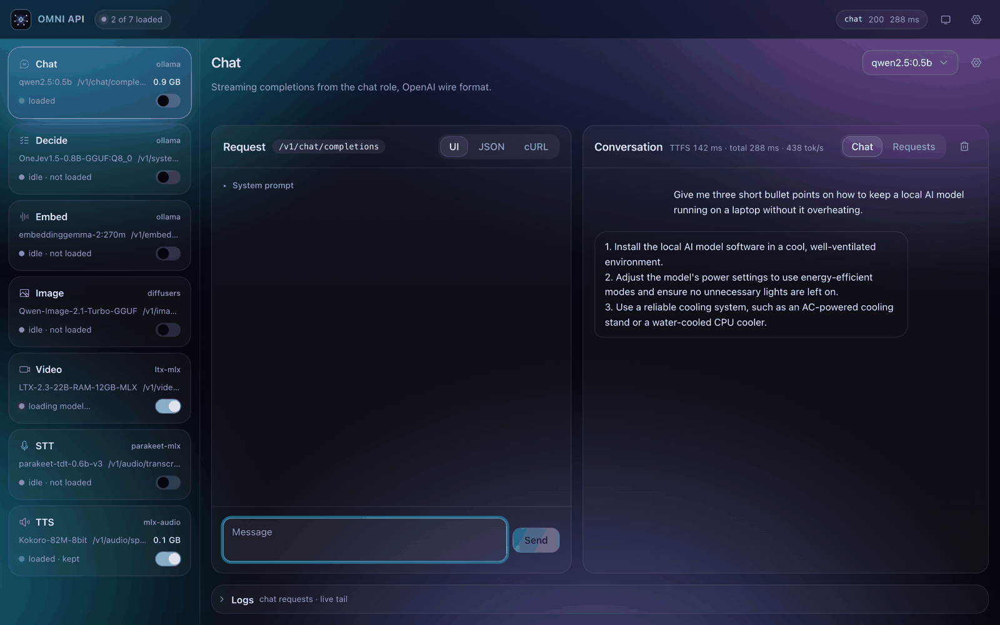

# omni-api

**Every local model your app needs, behind one port.**

omni is a local CLI. It runs, supervises and serves the models an app needs (chat, decisions, embeddings, speech-to-text and text-to-speech) on `127.0.0.1:10000`. Apps call a *role* such as `chat` or `tts`, never a model name or an engine port. Wherever an OpenAI format exists, omni uses it, so any OpenAI SDK works once you change its `base_url`.

The first client is Hyperlight.

## Screenshots



The playground at `/`: every role is a card on top (runner, endpoint, one status that says what its runtime is doing, and the single action that follows from it), and each tab is a workbench with a UI / JSON / cURL view of the same request.

---

## How it works

```
apps ──► 127.0.0.1:10000  omni gateway (FastAPI + httpx streaming proxy)
           /v1/chat/completions      ──► Ollama          OLLAMA_HOST, else 127.0.0.1:11434
           /v1/systemone             ──► Ollama          same instance, scored in the gateway
           /v1/embeddings            ──► Ollama          same instance, EmbeddingGemma task prompts added in the gateway
           /v1/images/generations    ──► image worker    unix:~/.omni-api/run/image.sock
           /v1/audio/transcriptions  ──► stt worker      unix:~/.omni-api/run/stt.sock
           /v1/audio/speech          ──► tts worker      unix:~/.omni-api/run/tts.sock
           /, /static            ──► built playground (src/omni/static/app)
```

- **Gateway** (`gateway/`): the FastAPI app (`gateway/app.py`) builds the shared context and mounts one module per route family (`gateway/routes/`). `gateway/proxy.py` streams each request through to its worker with httpx, filling in the default chat model when the request leaves `model` out.
- **Supervisor** (`supervisor/`):
  - `pool.py` spawns each worker in its own process group and probes `/health` every 2 s.
  - Restarts failed workers with exponential backoff, one lock per worker so a restart and the watch loop never overlap.
  - `process.py` records each child's pid and command line, so on `down` only a pid that is still ours is signalled; leftover workers from an earlier run are cleaned up on start.
- **Workers** (`workers/`): each role runs in its own uvicorn process, so a crash or memory spike in one model never takes down the others. Each loads its model on first use behind one lock and unloads it when idle.
- **Chat, decide and embed** use the machine's own Ollama address (`OLLAMA_HOST`, else `127.0.0.1:11434`). If nothing answers there, omni spawns `ollama serve` on that same address; it never moves Ollama to another port.
- **Decide** (`inference/decide.py`) turns each question into a lettered multiple-choice prompt, asks Ollama for one token with `top_logprobs`, and turns the option-letter probabilities into noul / choice / score answers. The prompt is OneJev's `qev-labels-v2` format, rendered as raw Qwen ChatML with thinking off.
- **Image** (`workers/image.py`) runs `QwenImage21Pipeline` from diffusers on MPS in bf16. `[image] steps` sets the default step count.

---

## Usage

```sh
omni init      # install Ollama if missing, pull the chat/decide/embed models
omni serve     # foreground: gateway + all workers
omni up        # same, in the background (logs: ~/.omni-api/logs/omni.log)
omni status    # worker health as JSON
omni down      # stop the gateway and every worker
```

Then open **http://127.0.0.1:10000/**.

### Playground

Preact + CSS modules, built with Vite from `web/` into `src/omni/static/app/` (the built files are checked in, so `omni up` needs no Node). After editing `web/`:

```bash
cd web && bun install && bun run build   # rebuild into src/omni/static/app
bun run dev                              # hot-reload dev server on :5180, proxies the API to :10000
```

Light, dark or system theme, picked in the sidebar. Its tabs:

- **Chat**: streaming replies with a token rate. An attach button appears when the model has Ollama's `vision` capability.
- **Decide**: yes/no (noul), choice and score questions, with probability bars.
- **Image**: prompt, size, steps, seed and negative prompt; shows and downloads PNGs.
- **Video**: prompt, size, length, seed and an optional first frame; queues a job, polls it and plays the mp4.
- **Models**: per-role default picker, installed models with delete, install from Ollama or Hugging Face with progress, and memory with warnings.
- **Embed**: rank documents against a query by cosine similarity.
- **STT**: record from the mic or upload a file; shows a transcript with segment timings.
- **TTS**: pick a voice and speed, play the result, and run a round trip back through stt.
- **Health**: worker status and loaded models.

---

## Cool features

- **Decide without generation:** `/v1/systemone` scores yes/no, choice and score questions from one token's logprobs — no generated text to parse, with calibrated probabilities per option.
- **Keep-warm pins:** pin a role and its model stays loaded (Ollama `keep_alive = -1`, workers re-loaded before idle unload). Pins persist across restarts.
- **Three views, one request:** every playground tab shows UI, raw JSON and a copyable cURL command for the exact body it sends.
- **Find & Install:** per-role Hugging Face / Ollama search filtered to what that role's runtime can actually run, with gated-repo "accept terms" handling and live download progress.
- **Self-healing workers:** per-worker locks, exponential-backoff restarts, pid + argv verification so a recycled pid is never signalled, and no orphan processes on `omni down`.
- **One error shape everywhere:** gateway, workers, routing 404/405 and validation 422 all return `{"error": {"message", "type"}}`.
- **Hardened local surface:** 8 MB JSON body caps (413), finite upstream timeouts, loopback-only by default — a non-loopback `--host` is refused unless `OMNI_ALLOW_NON_LOOPBACK=1` (admin routes have no auth, by design for a local-only tool).

---

## Why

A local-first AI app usually ends up juggling:

- Ollama on one port, a Python embedding server on another, and a speech model on a third.
- A different download step, start command and memory profile for each.
- Model names hard-coded across the app, so swapping a model breaks things.

omni brings all of that together:

| Goal | How |
|---|---|
| **One endpoint** | A single gateway on `127.0.0.1:10000` routes by path. Apps never see engine ports. |
| **Roles, not models** | Apps call `chat`, `decide`, `embed`, `image`, `video`, `stt` and `tts`. Config maps each role to a model, so swapping one never breaks an app. |
| **OpenAI-compatible** | `/v1/chat/completions`, `/v1/embeddings`, `/v1/images/generations`, `/v1/audio/transcriptions` and `/v1/audio/speech` follow OpenAI's wire format. Errors use OpenAI's shape. |
| **Light on memory** | Workers load their model on the first request and unload it after 10 idle minutes. |
| **Self-healing** | A supervisor health-checks every worker and restarts it with backoff. `omni down` leaves no orphan processes. |
| **Local only** | Binds `127.0.0.1`. Python workers listen on Unix sockets, not TCP. |

---

## What it can do

| Role | Endpoint | Default model | Engine |
|---|---|---|---|
| **chat** | `POST /v1/chat/completions` (streaming) | `qwen2.5:3b` | Ollama |
| **decide** | `POST /v1/systemone` | `hf.co/mradermacher/OneJev1.5-0.8B-GGUF:Q8_0` | Ollama (option-letter logprobs) |
| **embed** | `POST /v1/embeddings` | `embeddinggemma-2` (text) | Ollama |
| **image** | `POST /v1/images/generations` | `Qwen/Qwen-Image-2.1-Turbo` | diffusers (MPS, bf16) |
| **video** | `POST /v1/videos`, `GET /v1/videos/{id}`, `GET /v1/videos/{id}/content` | `dgrauet/ltx-2.5-mlx-q4` | ltx-2-mlx (LTX-2.5 distilled, 4-bit) |
| **stt** | `POST /v1/audio/transcriptions` | `mlx-community/parakeet-tdt-0.6b-v3` | parakeet-mlx |
| **tts** | `POST /v1/audio/speech`, `GET /v1/audio/voices` | `prince-canuma/Kokoro-82M-4bit` (27 voices) | mlx-audio |
| — | `GET /health`, `GET /v1/models` | | |
| — | `GET /admin/models`, `GET /admin/models/search`, `POST /admin/models/{pull,delete,default,load,unload}`, `POST /admin/workers/{name}/{start,stop,restart}`, `GET /admin/memory` | list, search Hugging Face (per-role filter), install, delete, switch, load and unload models; start, stop and restart workers; memory, CPU and load with overload warnings | |
| — | `GET /` | browser playground for every endpoint (`/playground` redirects here) | |

Measured on Apple Silicon:

- chat streams at about 140 tok/s.
- A warm embed takes 0.03–0.15 s.
- tts runs at about 12× realtime: 8 s of audio in 0.64 s.

---

## Install

On macOS (Apple Silicon) this installs every role. On Linux it installs chat, decide and embed; the stt, tts, image and video workers need MLX and Metal, so they are left out there. [Ollama](https://ollama.com) comes with `omni init` if missing, and Python plus [uv](https://docs.astral.sh/uv/) come with the script:

```sh
curl -fsSL https://raw.githubusercontent.com/nvkudva/omni-api/main/install.sh | sh
```

That installs the global `omni` command. Homebrew users on macOS can tap this repo instead:

```sh
brew tap nvkudva/omni
brew trust nvkudva/omni      # Homebrew 7+ refuses untrusted third-party taps
brew install omni
```

From a clone, for development (`-e` makes edits take effect immediately):

```sh
uv tool install -e ".[media]"    # macOS: every role
uv tool install -e .             # Linux: chat, decide, embed
# or run it without installing
uv run omni serve
```

Then:

```sh
omni init     # validate config, install Ollama if missing, pull chat/decide/embed
omni up       # gateway and workers in the background
```

`omni init` validates `~/.omni-api/config.toml`, installs Ollama when the binary is missing, waits for the server to answer, pulls the chat/decide/embed models and confirms they landed; every failure prints the command to fix it and a link. The stt, tts, image and video models download on first use. Release and packaging notes live in [`docs/publishing.md`](docs/publishing.md).

---

## API examples

Works with the OpenAI SDK:

```python
from openai import OpenAI

client = OpenAI(base_url="http://127.0.0.1:10000/v1", api_key="local")

client.chat.completions.create(model="qwen2.5:3b", messages=[{"role": "user", "content": "hi"}])
client.embeddings.create(model="embed", input=["refund policy", "shipping times"])
client.images.generate(model="image", prompt="a lighthouse at dawn", size="1024x1024")
client.audio.speech.create(model="tts", voice="af_heart", input="Hello from omni.").write_to_file("out.wav")
client.audio.transcriptions.create(model="stt", file=open("out.wav", "rb"))
```

Or with curl:

```sh
# chat (streaming)
curl -N localhost:10000/v1/chat/completions -H 'content-type: application/json' \
  -d '{"messages":[{"role":"user","content":"Say hi"}],"stream":true}'

# embeddings — input_type is "query" or "document" (EmbeddingGemma task prompts)
curl localhost:10000/v1/embeddings -H 'content-type: application/json' \
  -d '{"input":"how do I get a refund?","input_type":"query"}'

# image → png (Qwen-Image-2.1-Turbo; first call loads the model)
curl localhost:10000/v1/images/generations -H 'content-type: application/json' \
  -d '{"prompt":"a lighthouse at dawn","size":"1024x1024","steps":20}' | jq -r '.data[0].b64_json' | base64 -d > out.png

# text to speech → wav
curl localhost:10000/v1/audio/speech -H 'content-type: application/json' \
  -d '{"input":"Hello from omni.","voice":"af_heart"}' -o hello.wav

# speech to text — response_format: json | text | verbose_json
curl localhost:10000/v1/audio/transcriptions -F file=@hello.wav -F response_format=verbose_json

# decide — noul takes no criteria; choice needs a dict of 2 or more; score needs a list of 2 or more
curl localhost:10000/v1/systemone -H 'content-type: application/json' -d '{
  "state": "I have asked three times and still no refund!",
  "questions": {
    "is_frustrated": {"type": "noul", "instructions": "Does the customer sound frustrated?"},
    "topic": {"type": "choice", "instructions": "What is this about?",
              "criteria": {"billing": "money, refunds", "shipping": "delivery"}}
  }
}'

# video — a job: create, poll, then fetch the mp4
curl localhost:10000/v1/videos -H 'content-type: application/json' -d '{"prompt": "a paper boat in the rain", "size": "704x480", "seconds": 4}'
curl localhost:10000/v1/videos/video_abc123            # status: queued | in_progress | completed | failed
curl localhost:10000/v1/videos/video_abc123/content -o clip.mp4

# models — install streams NDJSON progress; ollama roles take an Ollama name or hf.co/<repo>:<quant>
curl localhost:10000/admin/models/pull -H 'content-type: application/json' -d '{"role": "chat", "model": "qwen2.5vl:7b"}'
curl localhost:10000/admin/models/default -H 'content-type: application/json' -d '{"role": "chat", "model": "qwen2.5vl:7b"}'
curl localhost:10000/admin/memory                      # RAM, swap, disk, CPU %, load average, per-worker status/RSS/CPU
curl 'localhost:10000/admin/models/search?role=tts&q=kokoro'   # only repos the role's runtime can run
curl localhost:10000/admin/models/load -H 'content-type: application/json' -d '{"role": "chat"}'   # 409 on a problem with this model; add "force": true
curl localhost:10000/admin/models/unload -H 'content-type: application/json' -d '{"role": "chat"}'
curl localhost:10000/admin/pins -H 'content-type: application/json' -d '{"role": "stt", "pinned": true}'  # keep it loaded
curl -X POST localhost:10000/admin/workers/tts/stop    # start | stop | restart; ollama runs outside omni
```

Every error uses the same shape: `{"error": {"message": "...", "type": "..."}}`. A `load` or a `pin`
that is refused because of something about *that* model answers `409` with `type: "overload"` and the
reasons in `error.blockers`; machine-wide pressure (swap, CPU, load average) is returned as
`advisories` instead, and never blocks a load.

### Keeping a model warm

A worker drops its model after `idle_unload_minutes` with no use, so the card switch in the playground
is a *pin*: turning it on loads the model now and holds it — a worker is re-loaded before it would
idle out, and an Ollama model is held with `keep_alive = -1`. Pins persist in
`~/.omni-api/pins.json` and are re-applied at startup, so a pinned role is warm again within a minute
of `omni up` without anyone sending a request.

The card says which of those is true right now, in one word, and the wording is the only status on
the card, so it can never disagree with the switch beside it:

| the card reads | what is true | what it offers |
| --- | --- | --- |
| `warm` | in memory, and held there | switch on — turn it off to let it unload |
| `running` | in memory now, but it unloads once idle | switch off — turn it on to hold it |
| `loading…` | held, and on its way into memory | switch on — turn it off to stop holding it |
| `not running` | not in memory; the next request loads it | switch off |
| `starting…` | the worker is coming up | — |
| `stopped` | the worker is down; for chat, decide and embed, Ollama itself is not answering | Start, or Server for the Ollama cases |
| `failed` | the worker keeps failing | Start — its log in Settings has the reason |
| `needs setup` | this role's default model cannot run here | Setup |

---

## Configuration

Defaults ship in `src/omni/catalog.toml`. To override any value, put it in `~/.omni-api/config.toml`; it is layered on top of the defaults:

```toml
[gateway]
port = 10000
idle_unload_minutes = 10

[chat]
model = "qwen2.5:3b"

[tts]
voice = "af_heart"
```

Set `OMNI_HOME` to move the state directory (default `~/.omni-api`):

| Path | Contents |
|---|---|
| `run/` | pidfiles, one socket per worker generation, and the stable `<role>.sock` link clients dial |
| `logs/` | one log per worker, plus `omni.log` |

Ports:

| Port | Use |
|---|---|
| 10000 | gateway |
| `OLLAMA_HOST` or 11434 | Ollama, reused or spawned on the machine's configured address |

---

## Notes and limits

- **The first request to each role is slow.** It loads the model, and some roles download on first use.
  Pin the ones you use often (the card switch in the playground, or `POST /admin/pins`) and they stay
  loaded instead:
  - **image:** loading Qwen-Image-2.1-Turbo takes about a minute; each 1024² image takes under a minute at 8 steps.
  - **video:** the LTX-2.5 4-bit pack is about 51 GB plus its Gemma text encoder; loading takes minutes. Ollama can't run video models, so this runs on MLX. The pack lives in a gated Hugging Face repo (`dgrauet/ltx-2.5-mlx-q4`, as does the q8 one), so accept its terms before the first run.
  - **stt stays unquantized:** parakeet-mlx loads dense checkpoints only, so a 4-bit parakeet pack cannot load.
  - **tts:** the first call also downloads a spaCy model and voice weights.
- **Ollama roles are never downloaded by a load.** `POST /admin/models/load` (and a pin) answers `409`
  `conflict` for an Ollama model that is not installed; install it with `POST /admin/models/pull` first.
  Worker roles are different — loading them does download the repo on first use.
- **Model downloads fail with `network is unreachable` and an IPv6 address.** The network hands out an
  IPv6 address but does not route it, and Ollama tries the host's IPv6 address first. Switch IPv6 to
  link-local only, then restart Ollama:
  ```
  networksetup -setv6LinkLocal Wi-Fi
  ```
  Undo it with `networksetup -setv6automatic Wi-Fi`. On Ethernet, find the service name with
  `networksetup -listallnetworkservices`. The same switch is in System Settings > Network > Details >
  TCP/IP > Configure IPv6.
- **Background runs inside agent sandboxes** may be stopped after a time limit. For long sessions, run `omni serve` in your own terminal.
- **tts voices:** American and British English only, since misaki[en] covers just those two.
- **Not yet built:** `pull`, `logs`, `test`, `bench`, and the WebSocket `/v1/realtime` (wake word, VAD and streaming speech).

## Project docs

- [`PLAN.md`](PLAN.md): architecture, decisions and rejected alternatives.
- [`TODO.md`](TODO.md): milestone checklist.
- [`REVIEW.md`](REVIEW.md): the 2026-10-16 architecture review and what it changed.

`web/` holds the playground source (Preact + CSS modules + Vite): `bun run build` writes
`src/omni/static/app`, and `bun test` renders every page headlessly so a page that only
breaks in the browser fails in CI.
